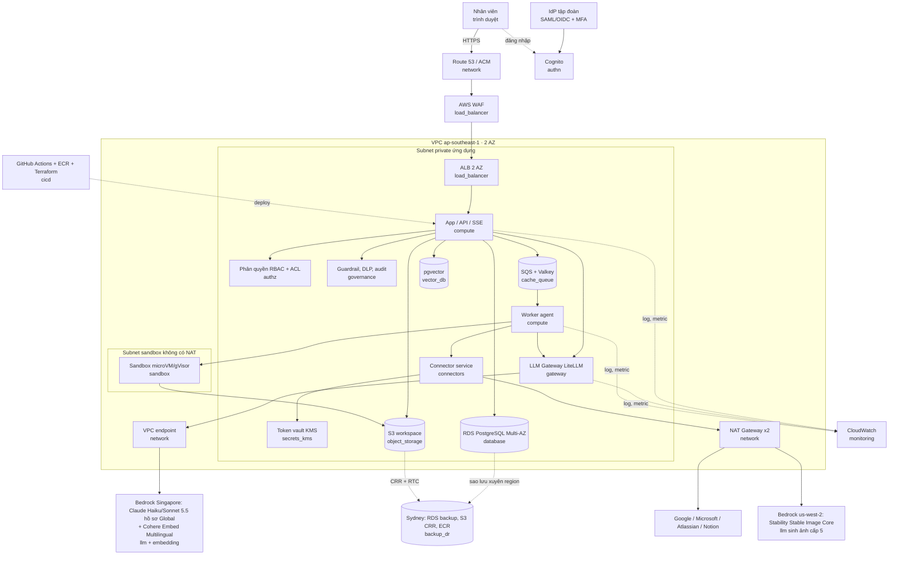

# Phần C: Hạ tầng, HA, vận hành (agent `tu`, đại diện Đinh Công Tú)

Ngày tra giá: **2026-10-16**. Region chính **ap-southeast-1 (Singapore)**, region DR **ap-southeast-2 (Sydney)**.
Nguồn giá: file giá chính thức của AWS (`https://pricing.us-east-1.amazonaws.com/offers/v1.0/aws/<Dịch vụ>/current/<region>/index.json`), kèm trang giá `aws.amazon.com/...` ghi ở `evidence/INDEX.md`.
**Mức chắc chắn:** đơn giá đã đối chiếu với file Price List chính thức (nguồn phụ). Trang giá `aws.amazon.com` tải tự động **không hiện số Singapore** (chỉ hiện us-east-1), nên các đơn giá E01-E08, E10-E12 đều là **CHƯA CÓ BẰNG CHỨNG trên trang** cho tới khi người dùng chụp (xem `evidence/INDEX.md`, mọi ảnh `chưa chụp`). Ngày tra mọi bằng chứng: 2026-10-16. Khối lượng (GB, số task, giờ) là giả định của tôi, dựa trên `docs/uoc-luong-tai.xlsx`.
Không dùng free tier, trial, credit, giá khuyến mãi; mọi hạn mức kèm gói đều bị bỏ qua và tính đủ.

Số đầu vào lấy từ bảng tải: 1,1 triệu request/tháng; burst ~4,2 req/s; 600 phiên đồng thời; ~38 sandbox đồng thời lúc burst; 88 GB egress connector; log 22 GB/tháng (audit 12 tháng 264 GB nằm ở S3 Object Lock, phần B); DB 300 GB gp3 (phần B); workspace ~3,9 TB (4.000 GB). Giờ: 24/7 = 730, hành chính = 220.

## 1. Quyết định chính

| Hạng mục | Chọn | Lý do |
|---|---|---|
| Compute | **ECS Fargate ARM (Graviton)**, không dùng EKS (Fargate có Linux/ARM ở Singapore: E17) | EKS thêm 0,10 USD/giờ/cluster (73 USD/tháng) + quản lý node; tải ~16 vCPU lúc đỉnh nhỏ, Fargate đủ. Graviton rẻ hơn x86 ~20% (0,04045 so với 0,05056 USD/vCPU-giờ) |
| AZ | **2 AZ** (Singapore có 3, dùng 2) | Đủ cho "một AZ mất"; thêm AZ thứ 3 cộng thêm 1 NAT (43,07) + 5 endpoint (47,45) ≈ 90 USD/tháng, không cần cho H7 |
| Scale | Giờ hành chính: cỡ đầy đủ; ngoài giờ: sàn 2 task nhỏ mỗi dịch vụ | SLA chỉ trong giờ hành chính nhưng người dùng vẫn có thể vào buổi tối; sàn rẻ (≈100 USD/tháng) |
| Staging | Chạy 220 giờ, về 0 ngoài giờ; dùng chung VPC, NAT, endpoint, ALB (host rule) | Tiết kiệm ≈ 110 USD/tháng (ALB 18 + 1 NAT 43 + endpoint 47) so với staging có hạ tầng mạng riêng |
| LLM observability | CloudWatch (log, metric tự đẩy qua EMF, alarm) + bảng chi tiêu LiteLLM trong RDS (phần A) | Langfuse tự host cần ClickHouse + Redis + 3 dịch vụ: ≈ (5 vCPU, 14 GB) tính theo giá Fargate trên ≈ 125 USD/tháng và thêm ~0,25 FTE. Chưa cần ở quy mô này; nêu như phương án nâng cấp |
| AWS Support | **Không mua gói trả phí** (chỉ Basic) | Business Support+ = max(29 USD; 9% tới 10.000 USD + 7% từ 10.000 tới 80.000 USD hóa đơn AWS, trang `premiumsupport/pricing` ngày 2026-10-16). Hóa đơn AWS cả bài ước ~15.000-25.000 USD thì phí ≈ 900-1.950 USD/tháng, bằng cả khoản hạ tầng phần C. Rủi ro: không có hỗ trợ sự cố mức P1 từ AWS; bù bằng 1,5 FTE và diễn tập DR. **Cần nhóm đồng ý** |

## 2. Chi phí phần C (chi tiết ở `docs/baogia-C.tsv`)

| Component | USD/tháng | Gồm |
|---|---|---|
| compute | 191,24 | prod app 68,51; worker 111,89; staging 10,84 (gateway do component `gateway` của phần A tính, kể cả task staging) |
| load_balancer | 42,00 | ALB giờ 18,40; LCU 7,60; WAF 16,00 |
| network | 225,65 | NAT 2 cái 86,14 + dữ liệu 207 GB 12,21 (thêm ~57 GB ảnh từ us-west-2); 5 endpoint × 2 AZ 94,90 + dữ liệu 1,10; chéo AZ 6,00; ra internet 24,00; Route 53 1,30 |
| backup_dr | 172,83 | RDS (DB 300 GB): backup SG 38 (400 GB); chép xuyên region 18 (200 GB); lưu Sydney 38; S3 DR Glacier IR 20; CRR truyền + RTC + 5 metric 22,50; PUT 2; chép lần đầu (30/tháng, 360 một lần ÷ 12) 30; ECR 2,85; diễn tập 1,48 (76 giờ/năm) |
| monitoring | 45,16 | log ứng dụng nhập 10,50, lưu 30 ngày 0,45; Insights 0,21; alarm 4; custom metric 30. **Audit 12 tháng không ở CloudWatch** (đã có ở S3 Object Lock, phần B 6,60) để khỏi tính hai lần |
| cicd | 16,50 | GitHub Actions 15 (3.000 phút arm64); ECR 1,50 |
| licenses | 12,00 | GitHub Team 3 seat |
| ops_labor | 5.450,00 | xem mục 5 |
| contingency | 35,27 | 5% trên 705,38 (mọi dòng không phải nhân sự của phần C) |
| **Tổng phần C** | **6.190,65** | chưa gồm phần A, B và dòng TOTAL |

Hạng mục lớn nhất của phần C là nhân sự (88%). Hạ tầng thuần chỉ ~705 USD/tháng.

### Cách tính compute (Graviton: 0,04045 USD/vCPU-giờ, 0,00442 USD/GB-giờ)

| Dịch vụ | Giờ cao (220h) | Ngoài giờ (510h) | Giờ cao USD/giờ | Ngoài giờ USD/giờ |
|---|---|---|---|---|
| app/API/SSE | 4 × (1 vCPU, 2 GB) | 2 × (0,5; 1) | 0,19716 | 0,04929 |
| worker agent | 4 × (2; 4) | 2 × (0,5; 1) | 0,39432 | 0,04929 |

Gateway LiteLLM (2 task, mỗi AZ 1 task) do phần A tính trong component `gateway`; tôi chỉ giữ cỡ để thiết kế HA (mỗi task tự gánh cả tải đỉnh). Căn cứ cỡ: burst 4,2 req/s, 600 SSE; ~8,7 lời gọi LLM/giây qua gateway (cấp 4 nhiều bước, ước tính của tôi); ~57 agent chạy đồng thời lúc burst (0,63 req/s cấp 4 × ~90 giây), mỗi task worker ~15 agent vì chủ yếu chờ I/O. **Các cỡ này chưa được đo**, cần load test trước khi chốt (mục 4).

## 3. HA và DR (H7)

### 3.1 Từng thành phần chạy mấy AZ

| Thành phần | Triển khai | Một AZ mất thì |
|---|---|---|
| WAF + ALB | ALB trải 2 AZ (managed) | Tự loại AZ lỗi, không cần làm gì |
| App/API | ≥ 2 task, 2 mỗi AZ giờ cao | AZ còn lại gánh tiếp; ECS dựng task bù trong ~2-4 phút |
| Gateway | ≥ 2 task, 1 mỗi AZ, mỗi task đủ gánh cả tải đỉnh | Không giảm năng lực |
| Worker + SQS | 4 task, 2 mỗi AZ; SQS là dịch vụ cấp region | Job đang chạy ở AZ lỗi tự hiện lại sau visibility timeout, chạy lại từ checkpoint |
| NAT | 1 mỗi AZ, route table riêng từng AZ | AZ sống dùng NAT của nó; connector không ảnh hưởng |
| VPC endpoint | có ENI ở cả 2 AZ | Vẫn gọi Bedrock qua AZ còn lại |
| RDS PostgreSQL (phần B) | Multi-AZ instance (không phải Multi-AZ cluster, vì cross-region backup chỉ hỗ trợ instance) | Failover tự động; standby đồng bộ ở AZ khác (E18). Thời gian 60-120 giây: **CHƯA CÓ BẰNG CHỨNG** (trang tài liệu không nêu số), phải đo |
| ElastiCache (phần B) | có replica khác AZ | Promote replica ~30-60 giây (**CHƯA CÓ BẰNG CHỨNG**, phần B); cache mất không làm mất dữ liệu gốc |
| S3 | lưu đa AZ mặc định | Không ảnh hưởng |
| Bedrock | dịch vụ cấp region; Claude 5.5 ở Singapore chỉ qua hồ sơ Global (E26) | Không ảnh hưởng; cần quota đủ (mục 4) |

Không có điểm lỗi đơn ở LB, gateway, database.

### 3.2 Kịch bản "một AZ mất lúc 10 giờ sáng"

| Mốc | Chuyện xảy ra | Người dùng thấy |
|---|---|---|
| T+0 | Mất AZ-a (app, gateway, worker, NAT, endpoint, DB primary có thể nằm ở đây) | Các luồng SSE đang chạy ở AZ-a bị ngắt |
| T+10-30 s | ALB đánh dấu target AZ-a lỗi (health check 10 s × 2) | Trình duyệt tự kết nối lại (client gửi `last-event-id`), chuyển sang AZ-b |
| T+1-2 phút | RDS standby lên primary; app thử lại với backoff | Vài giây tới ~2 phút chat chậm hoặc báo "đang kết nối lại" |
| T+2-4 phút | ECS khởi tạo task thay thế ở AZ-b; alarm "AZ lỗi" báo người trực | Bình thường |
| T+5-15 phút | Job agent dở dang hiện lại trong SQS, worker AZ-b chạy lại | Agent nền chậm vài phút nhưng xong trong 10 phút (H6) trừ job vừa khởi động |
| Mất dữ liệu | Giao dịch đã commit trong RDS: 0 (ghi đồng bộ). Mất: tin nhắn đang gõ dở chưa gửi, lượt sandbox đang chạy (chạy lại được) | Không có file bị mất |

So với yêu cầu: RTO thực tế vài phút << 4 giờ; RPO ≈ 0 << 1 giờ. Ngân sách 99,5% giờ hành chính = 0,5% × 220 giờ = **1,1 giờ/tháng**; một sự cố AZ như trên tiêu hết vài phút, còn dư.

### 3.3 Mất cả region Singapore (DR)

Kiểu **pilot light / dựng lại bằng Terraform** ở Sydney, không chạy compute sẵn:

| Dữ liệu | Cách bảo vệ | RPO ước tính |
|---|---|---|
| RDS PostgreSQL | Cross-Region automated backup replication → Sydney (hỗ trợ cho Multi-AZ DB instance của PostgreSQL, tài liệu AWS `USER_ReplicateBackups`, đã đọc, E09); khôi phục PITR | vài phút tới < 1 giờ (WAL sao chép liên tục; **cần đo độ trễ thật**) |
| S3 workspace | CRR + Replication Time Control sang bucket Sydney, lớp Glacier Instant Retrieval | ≤ 15 phút cho 99,9% object (RTC, E19); lớp đích Glacier IR cùng RTC: **CHƯA CÓ BẰNG CHỨNG** |
| Image | ECR replication sang Sydney | 0 (chạy khi push) |
| Hạ tầng | Terraform (state trong S3 có CRR) | không áp dụng |
| Cache/hàng đợi | Không sao lưu, dựng mới | mất job đang chạy |

RTO ước tính (**chưa đo, chỉ là kế hoạch**): quyết định chuyển DR 0:15; `terraform apply` dựng VPC + ECS + ALB 0:30; khôi phục RDS 300 GB từ backup replicated 1:30-2:30 (bắt đầu song song ngay sau quyết định, không chờ Terraform); nạp lại cấu hình, smoke test 0:30; đổi DNS Route 53 0:10. Vì khôi phục DB chạy song song với Terraform nên tổng ≈ **2,5-3,5 giờ**; nếu làm tuần tự thì 3-4 giờ, sát RTO 4 giờ, nên bắt buộc song song và phải đo ở game day (DB 300 GB là đoạn dài nhất). Rủi ro: Bedrock ở Sydney: trang tài liệu cho thấy Claude Haiku 5.5 và Sonnet 5.5 ở ap-southeast-2 có hồ sơ Geo và Global (E26, đã đọc 2026-10-16), nhưng quota ở Sydney **CHƯA CÓ BẰNG CHỨNG**; Cohere Embed Multilingual ở Sydney và Stable Image Core (chỉ us-west-2, không đổi khi DR) chưa kiểm; KMS và secret cần khóa multi-region (phần B).

### 3.4 Lịch diễn tập khôi phục (backup phải được kiểm thử)

| Tần suất | Việc | Đạt khi |
|---|---|---|
| Hằng tháng (tự động, 3 giờ) | Khôi phục bản backup replicated mới nhất (DB 300 GB) ở Sydney vào instance tạm, chạy kiểm tra số dòng, checksum, truy vấn vector mẫu | Khôi phục xong < 150 phút, kiểm tra đạt |
| Hằng quý (10 giờ) | Game day: dựng toàn bộ stack ở Sydney bằng Terraform, khôi phục DB + trỏ staging domain, bấm giờ | Tổng thời gian < 3,5 giờ, ghi biên bản |
| 6 tháng | Mô phỏng mất AZ ở staging (tắt subnet 1 AZ), đo failover RDS, ALB, ECS | Người dùng thấy gián đoạn < 5 phút |
| Mỗi lần đổi cấu hình lớn | `terraform plan` bắt buộc, drift check hằng tuần | Không drift |

Chi phí diễn tập đã tính trong dòng "Diễn tập khôi phục" (76 giờ db.m7g.large/năm: 12 lần × 3 giờ + 4 lần × 10 giờ).

## 4. Độ trễ (H6): p95 thời gian tới token đầu < 3 giây

**Toàn bộ là ước lượng, chưa đo.** Chưa có load test, chưa kiểm quota Bedrock.

| Chặng | p95 ước tính | Ghi chú |
|---|---|---|
| WAF + ALB + TLS | 30-60 ms | |
| App: xác thực JWT, nạp phiên | 20-50 ms | Redis/Valkey cache |
| Embedding câu hỏi (Cohere Embed Multilingual, Singapore, E26) | 100-250 ms | chạy song song với phân loại cấp tác vụ |
| Truy vấn pgvector + RLS | 30-120 ms | HNSW, lọc quyền trong truy vấn |
| Rerank (nếu có) | 150-400 ms | **bỏ ở cấp 1** nếu thiếu ngân sách |
| Guardrail đầu vào | 100-300 ms | Bedrock Guardrails hoặc regex/Presidio cục bộ (phần B) |
| Gateway LiteLLM | 10-50 ms | |
| Token đầu từ model nhỏ (lớp Haiku) | 600-1.500 ms | |
| Token đầu từ model trung (lớp Sonnet) | 1.200-2.500 ms | |
| Thêm do hồ sơ Global của Claude 5.5 (xử lý ở region bất kỳ, E26) | +0-250 ms | RTT tới region xử lý; **CHƯA CÓ BẰNG CHỨNG**, cần đo |
| **Tổng cấp 1 (nhỏ)** | **~1,2-2,4 s** | đạt |
| **Tổng cấp 2-3 (lớp Sonnet)** | **~2,3-3,6 s** | **có nguy cơ vượt 3 s** |

Điểm nghẽn có thể có, theo mức nguy hiểm:
1. **Quota Bedrock (nguy hiểm nhất).** Burst ≈ 43.000 token vào/giây ≈ 2,6 triệu token/phút. Hạn mức mặc định của Claude 5.5 ở Singapore: **CHƯA CÓ BẰNG CHỨNG** (trang quotas, E38 của phần A, chưa đọc); chỉ biết là thường thấp hơn nhiều. Nếu bị throttling, TTFT vọt lên và request thất bại. Việc cần làm: xin tăng quota từ sớm, dùng inference profile cross-region, giảm token vào bằng prompt cache, và gateway có hàng đợi + fallback sang model khác.
2. Claude 5.5 ở Singapore chỉ có hồ sơ Global (E26) nên request có thể được xử lý ở region khác, thêm RTT và độ lệch; ảnh cấp 5 gọi sang us-west-2 (không nằm trên đường chat nên không tính vào H6).
3. Rerank và guardrail đặt nối tiếp. Cách xử lý: chạy song song embedding với kiểm guardrail, bỏ rerank cấp 1, stream trạng thái "đang tìm tài liệu" ngay để người dùng thấy phản hồi.
4. RDS/pgvector nghẽn khi 600 phiên cùng truy vấn: dùng pool kết nối (RDS Proxy hoặc pgbouncer), HNSW đủ RAM.
5. Cold start: sàn ngoài giờ 2 task; giờ cao điểm scale theo lịch 07:30 để task đã nóng trước 8:00 (Fargate khởi động 1-2 phút).
6. Không dùng mô hình suy luận dài (kiểu R1) cho chat tương tác; vi phạm H6.

Kế hoạch đo: k6 hoặc Locust mô phỏng 600 phiên, 4,2 req/s trong 30 phút, đo `time_to_first_token` p50/p95/p99 theo cấp; cảnh báo khi p95 > 2,5 s trong 5 phút. Agent nền (cấp 4) xong < 10 phút: đo riêng và thông báo khi xong.

## 5. Nhân sự vận hành, giấy phép, dự phòng

### ops_labor: 1,5 FTE, 5.450 USD/tháng

| Vai | FTE | USD/tháng | Việc |
|---|---|---|---|
| SRE/Platform senior | 1,0 | 3.500 | Terraform, CI/CD, HA/DR diễn tập, sự cố, FinOps, vá bảo mật |
| LLMOps/MLOps | 0,5 | 1.750 | Bộ eval gate, routing, quota Bedrock, theo dõi chất lượng và token theo cấp |
| Phụ cấp trực | n/a | 200 | Luân phiên 2 người; giờ hành chính có người trực, ngoài giờ chỉ nhận cảnh báo nghiêm trọng |

Lương tham khảo: senior DevOps Việt Nam 2.200-3.200 USD/tháng (~55-80 triệu VND, tỷ giá ~25.000; nguồn [reliasoftware](https://reliasoftware.com/blog/devops-engineer-salary-in-vietnam), các nguồn khác cho 32 triệu VND trung bình mọi cấp ([JobsGO](https://jobsgo.vn/muc-luong-ky-su-devops.html)) tới 80-110 triệu ([secondtalent](https://www.secondtalent.com/developer-rate-card/devops-engineer-vietnam/))). Lấy 2.700 USD × 1,3 (BHXH phía công ty ~21,5%, thưởng tháng 13, thiết bị) = 3.510 ≈ 3.500. **Chưa kiểm** tỷ giá và hệ số 1,3. Vì sao 1,5 FTE: 1 người không đủ để vừa trực vừa nghỉ phép (rủi ro một người); phần LLMOps cần thiết vì H8 buộc phải chạy eval mỗi khi đổi model. Phương án rẻ hơn: 1,0 FTE (giảm 1.750 USD), đổi lại rủi ro chất lượng và không ai phụ trách eval.

### licenses: 12 USD
GitHub Team 3 seat × 4 USD. Trang giá ghi "first 12 months", **không rõ giá sau 12 tháng, cần kiểm**. Terraform CLI, LiteLLM, Presidio là mã nguồn mở. Support: xem mục 1.

### contingency: 5%
5% trên 705,38 USD (hạ tầng phần C không gồm nhân sự) = 35,27. Đơn giá AWS đã cố định theo giá niêm yết; rủi ro còn lại là khối lượng log, truyền dữ liệu. Rủi ro lớn hơn là token LLM (±30%), phần đó không dùng dự phòng mà kiểm soát bằng quota theo người/đơn vị và cắt ngưỡng (H8). **Khi ghép bài:** đặt dòng contingency = 5% × tổng mọi dòng không phải `ops_labor` và `contingency` của A+B+C (công thức Excel `=ROUND(0.05*(SUMIFS(...)),2)`), thay cho số 35,27 này.

## 6. Sơ đồ kiến trúc tổng thể



Mã component hợp lệ: `compute, load_balancer, network, backup_dr, monitoring, cicd, gateway, llm, embedding, database, vector_db, object_storage, cache_queue, sandbox, connectors, authn, authz, secrets_kms, governance`. (Sơ đồ chưa vẽ riêng hộp `licenses`, `ops_labor`, `contingency` vì không phải hạ tầng chạy.)

## 7. Luồng một request

```mermaid
sequenceDiagram
  autonumber
  participant U as Nhân viên
  participant IdP as IdP + Cognito (authn)
  participant L as WAF/ALB (load_balancer)
  participant A as App (compute)
  participant Z as authz + governance
  participant D as RDS/pgvector (database, vector_db)
  participant G as Gateway (gateway)
  participant M as Bedrock (llm)
  participant Q as SQS (cache_queue)
  participant W as Worker (compute)
  participant C as Connector (connectors, secrets_kms)
  participant S as Sandbox (sandbox)
  U->>IdP: SSO + MFA
  IdP-->>U: ID/Access token (JWT)
  U->>L: HTTPS + JWT
  L->>A: chuyển tiếp sau WAF
  A->>Z: kiểm quyền, guardrail đầu vào, che PII
  A->>D: embedding + tìm kiếm có RLS theo user
  A->>G: prompt + ngữ cảnh + khóa theo user
  G->>M: gọi qua VPC endpoint (cấp 1-3: stream)
  M-->>G: token (stream)
  G-->>A: token (stream) + ghi chi phí
  A-->>U: SSE: token đầu tiên
  Note over A,Q: Cấp 4 (agent) chạy nền
  A->>Q: đưa job
  Q->>W: nhận job
  W->>C: lấy token OAuth của user từ vault, gọi Jira/Notion/Gmail qua NAT
  W->>S: chạy code (STS giới hạn prefix S3 của user, không egress)
  S-->>W: kết quả
  W->>G: bước tiếp theo của agent
  W->>Z: xin xác nhận người dùng trước hành động ghi
  Z-->>U: thông báo hoàn tất / xin xác nhận
  A->>D: lưu lịch sử chat; ghi audit vào S3 Object Lock (phần B)
```

## 8. Đối chiếu ràng buộc cứng

| | Kết quả | Chỗ còn hở |
|---|---|---|
| H1 Cloud | AWS ap-southeast-1; Bedrock qua VPC endpoint; DR ở Sydney | Claude 5.5 ở Singapore chỉ qua hồ sơ Global (xử lý ở region bất kỳ, E26, E28 phần A); ảnh gọi sang us-west-2 qua NAT. Đây là điểm hội đồng có thể hỏi về H1 |
| H6 Độ trễ | Ước lượng đạt cấp 1, rủi ro ở cấp 2-3 | Chưa đo; quota Bedrock chưa kiểm |
| H7 HA/DR | Không SPOF ở LB, gateway, DB; RTO ~3 giờ, RPO < 1 giờ trên giấy; có lịch diễn tập | Chưa diễn tập thật; RTO/RPO là ước tính; 99,5% = 1,1 giờ/tháng |
| H2-H5, H8 | Phần B và A | Phần C chỉ cấp hạ tầng: subnet sandbox không NAT, endpoint riêng, log ứng dụng ở CloudWatch; audit 12 tháng ở S3 Object Lock (phần B) |

## 9. Phụ thuộc vào phần của người khác
- Phần B: kích cỡ DB (đã theo phần B: 300 GB gp3; RDS staging riêng 81,36 USD do phần B tính, tôi không tính lại), danh sách endpoint cần thêm (Secrets Manager, ECR nếu sandbox dùng Fargate: mỗi endpoint thêm 18,98 USD/tháng).
- Phần A: số task gateway nếu thêm cache ngữ nghĩa; quota Bedrock; model có ở Sydney khi DR.

## 10. Rà soát dịch vụ, SKU, region của phần C (theo quy tắc 9-11)

Đối chiếu từng giả định với trang tài liệu chính thức đọc ngày 2026-10-16. Mã bằng chứng xem `evidence/INDEX.md`.

| Giả định | Kết quả | Chênh lệch chi phí |
|---|---|---|
| Fargate Linux và ARM64 chạy ở ap-southeast-1 | **Có** (E17: bảng vùng hỗ trợ có Singapore; ARM chỉ loại use1-az3) | 0 |
| Endpoint `bedrock-runtime` ở Singapore | Endpoint dịch vụ **có** (E18, bảng Bedrock runtime). Trang PrivateLink chỉ nêu tên service chung `com.amazonaws.{region}.bedrock-runtime`, không liệt kê riêng Singapore: **CHƯA CÓ BẰNG CHỨNG** cho interface endpoint ở Singapore, phải thử tạo trong console | 0 nếu có. Nếu không có: bỏ endpoint Bedrock −18,98 (2 AZ × 730 × 0,013) và Bedrock đi qua NAT ~55 GB × 0,059 = +3,25, tức −15,73 (nhưng H1 yếu hơn) |
| RDS PostgreSQL Multi-AZ instance chép backup sang Sydney | **Có** (E09, bảng cặp region Singapore→Sydney) | 0 |
| S3 CRR + RTC Singapore→Sydney, lớp đích Glacier IR | RTC: tài liệu có (E19), số liệu SLA là **99,9%** trong 15 phút (bản đầu của tôi ghi 99,99%, đã sửa). **Lớp Glacier IR kết hợp RTC: CHƯA CÓ BẰNG CHỨNG** (không đọc được trang tài liệu). Nếu không dùng được Glacier IR thì dùng Standard-IA Sydney: 4.000 GB × 0,0138 = 55,20 so với 20,00 | +35,20 (chỉ khi phải đổi) |
| Stable Image Core chỉ ở us-west-2 (phần A, E26) | Ảnh đi qua NAT tới `bedrock-runtime.us-west-2`; ~57 GB/tháng qua NAT | **+3,36** (đã cộng vào network) |
| Phí truyền dữ liệu ra từ us-west-2 cho phản hồi Bedrock | **CHƯA CÓ BẰNG CHỨNG** (chưa thấy trang nào nói AWS tính hay không) | Không cộng; nếu tính 0,09 USD/GB thì tối đa +5,10 |
| Claude 5.5 ở Sydney khi DR | Haiku 5.5 và Sonnet 5.5: ap-southeast-2 có Geo và Global (E26) | 0 |
| Cohere Embed Multilingual ở Sydney, Opus ở Sydney | **CHƯA CÓ BẰNG CHỨNG** (chưa đọc được phần bảng) | chưa tính |
| Failover RDS 60-120 giây, ElastiCache 30-60 giây | **CHƯA CÓ BẰNG CHỨNG** (đã rút câu "theo tài liệu AWS") | 0, ảnh hưởng RTO |
| Hạn mức Bedrock cho 2,6 triệu token/phút | **CHƯA CÓ BẰNG CHỨNG** (E38 của phần A chưa đọc) | rủi ro H6, không tính tiền |
| GitHub Team 4 USD/người | Trang ghi "first 12 months" | chưa rõ; ảnh hưởng tối đa vài USD (3 seat) |
| Giá Price List khớp trang web | **Chưa kiểm** cho E01-E08, E10-E12 (trang không hiện Singapore khi đọc tự động) | rủi ro lệch nếu trang khác JSON |

Không có dịch vụ nào của phần C bị loại vì không có ở Singapore. Tổng chênh lệch đã cộng so với bản trước: **+5,10 USD** (NAT +3,36; metric RTC +1,50; dự phòng 5% +0,24). Tổng cột chi phí `baogia-C.tsv`: trước **6.185,55**, sau **6.190,65**.

TRẠNG THÁI: XONG
